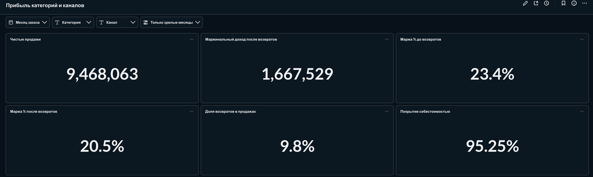
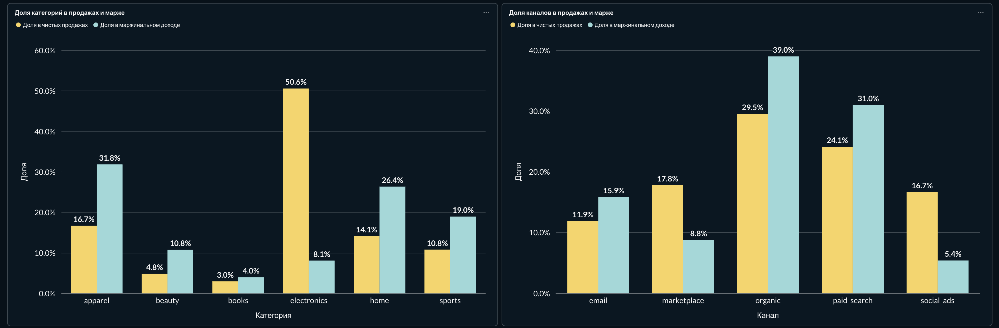
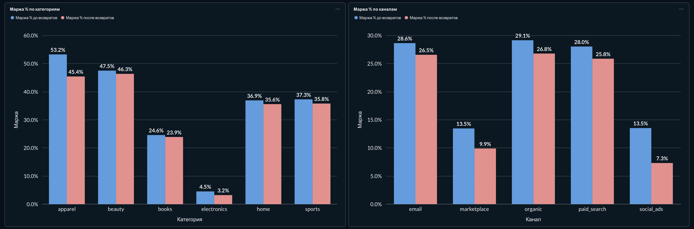
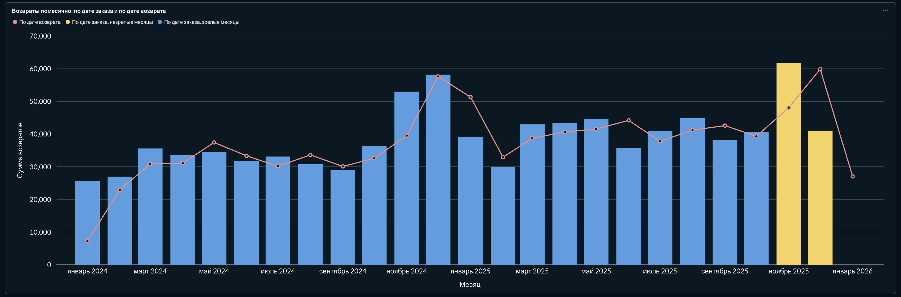
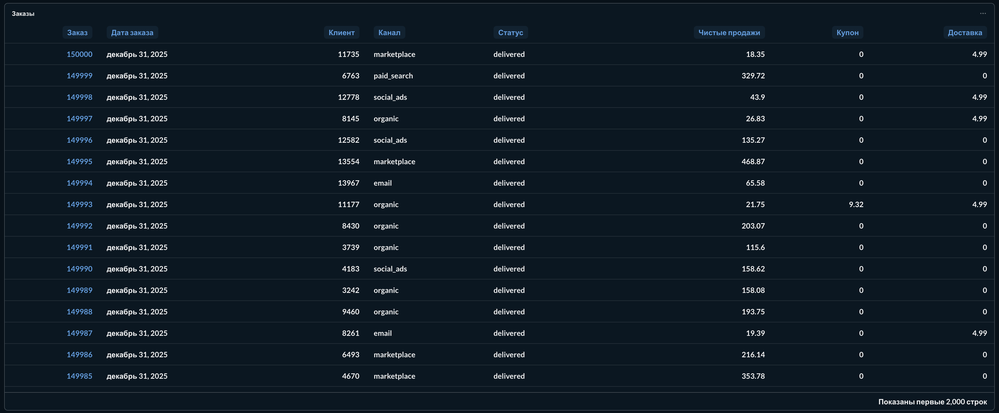

# Маржа и возвраты интернет-магазина

Какие категории и каналы действительно зарабатывают, а какие создают выручку без прибыли, и как меняется картина после учёта возвратов. Данные — заказы за 2024–2025 годы, выгрузка на 15 января 2026.

## Главные выводы

- Чистые продажи 9,47 млн, возвраты 930,6 тыс. (9,8%). Маржинальный доход 2,11 млн до возвратов и 1,67 млн после: маржа падает с 23,4% до 20,5%.
- Electronics даёт 50,6% чистых продаж и 8,1% маржинального дохода, маржа 4,5% до возвратов и 3,2% после.
- Apparel — самая маржинальная категория до возвратов (53,2%), но возвращается 23,8% позиций. После возвратов маржа 45,4%, на категорию приходится около 60% потерянной на возвратах маржи.
- Social_ads: 16,7% продаж и 5,4% маржинального дохода, маржа падает с 13,5% до 7,3% — сильнее, чем в остальных каналах.

Подробности и гипотезы — в [memo.md](memo.md).

## Архитектура

raw (CSV как есть, все поля text) → staging (dbt views: дедупликация, типы, нормализация статусов) → marts (dbt tables: факты, измерения, витрины по месяцу × категории × каналу) → Metabase (дашборд по витринам).

## Корректность

- Гранулярность зафиксирована для каждой таблицы: заказ, позиция, событие возврата. Ключи проверяются тестами `unique` и `not_null`, связи — тестами `relationships`.
- Суммы не размножаются при JOIN. Купон распределяется по позициям оконной функцией, поэтому сумма долей равна купону заказа. В витринах продажи и возвраты сначала агрегируются отдельно до одного ключа (месяц × категория × канал), потом соединяются.
- Правила учёта выручки, возвратов, отмен и себестоимости — в [docs/business_rules.md](docs/business_rules.md).
- Тесты сверки в `dbt/tests`:
  - чистые продажи в фактах сверяются с независимым расчётом по staging: list_price × quantity − скидка − купон;
  - итоги витрин сверяются с фактами;
  - итог возвратов по дате заказа равен итогу по дате возврата;
  - сумма возврата совпадает с `refund_amount`, возвращённое количество не превышает проданное.

## Три вопроса

**Почему выручка в двух отчётах различается.** Возврат можно отнести к месяцу заказа или к месяцу возврата. Итог за период одинаковый (930,6 тыс.), помесячные значения различаются. По дате возврата есть январь 2026 с возвратами на 27 тыс., хотя заказов в нём нет.

**Как обрабатывается возврат следующего месяца.** Во взгляде по дате заказа, основном для категорий и каналов, возврат уменьшает месяц исходного заказа. Окно возврата 60 дней, поэтому ноябрь и декабрь 2025 помечены как незрелые: декабрь (41 тыс. возвратов) выглядит лучше ноября (62 тыс.) только потому, что его возвраты ещё не пришли. На дашборде есть фильтр «Только зрелые месяцы».

**Можно ли считать прибыль при неизвестной себестоимости.** Только на части продаж: маржа считается по позициям с известной себестоимостью, они покрывают 95,25% чистых продаж. Для оставшихся 449,7 тыс. в ноутбуке есть оценка через медианную долю себестоимости категории — 93,5 тыс. маржи. Она помечена как оценка и в итоги не входит.

## Запуск

Нужны Docker и uv.

```
make setup   # окружение .venv на Python 3.12
make all     # данные, Postgres и Metabase, загрузка raw, dbt build, дашборд
```

Metabase: http://localhost:3001, логин `admin@example.com`, пароль `Metabase-local-1` (переопределяются через `MB_ADMIN_EMAIL` и `MB_ADMIN_PASSWORD`). Postgres: `localhost:5434`, база `ecommerce`, пользователь и пароль `analyst`.

Другие цели: `make notebook` — перевыполнить ноутбук, `make reset-db` — удалить тома и собрать всё заново, `make down` — остановить контейнеры.

## Дашборд







## Структура

```
dbt/
  models/staging/   очистка и типы
  models/marts/     факты, измерения, витрины
  tests/            тесты сверки
docs/               правила учёта, скриншоты
notebooks/          анализ маржи
src/                генерация данных, загрузка raw, настройка Metabase
memo.md             записка с выводами
```
